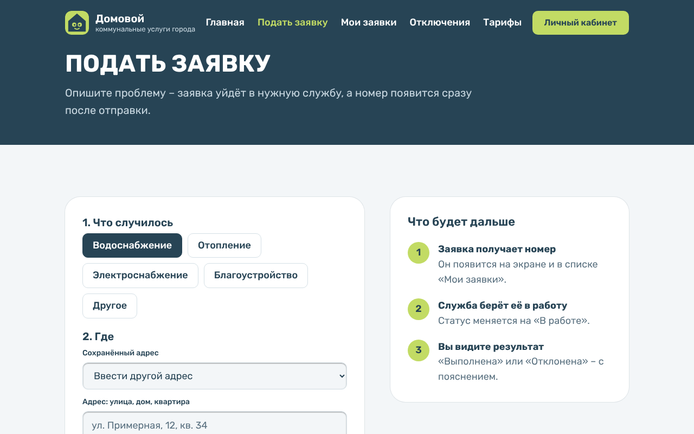
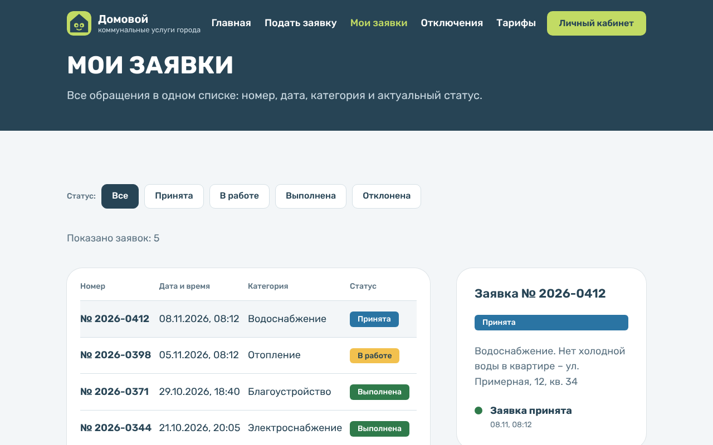
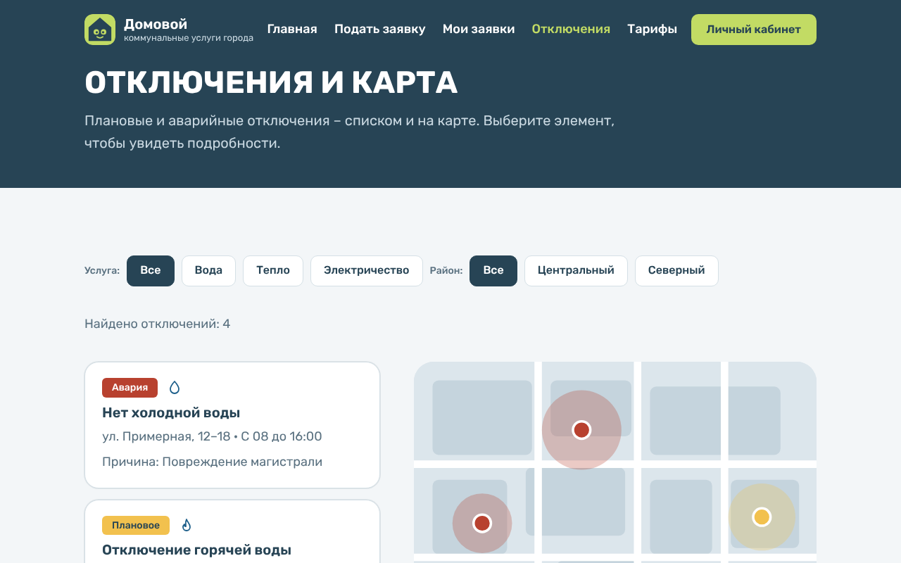
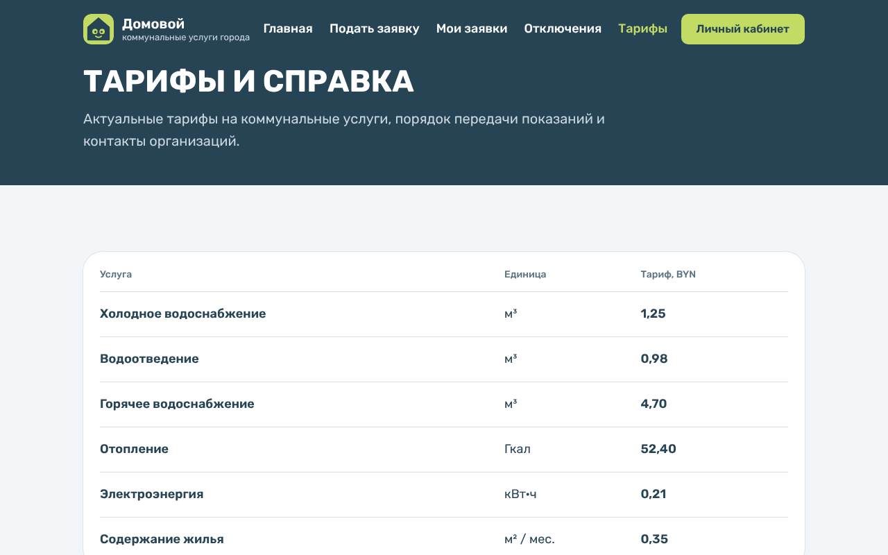
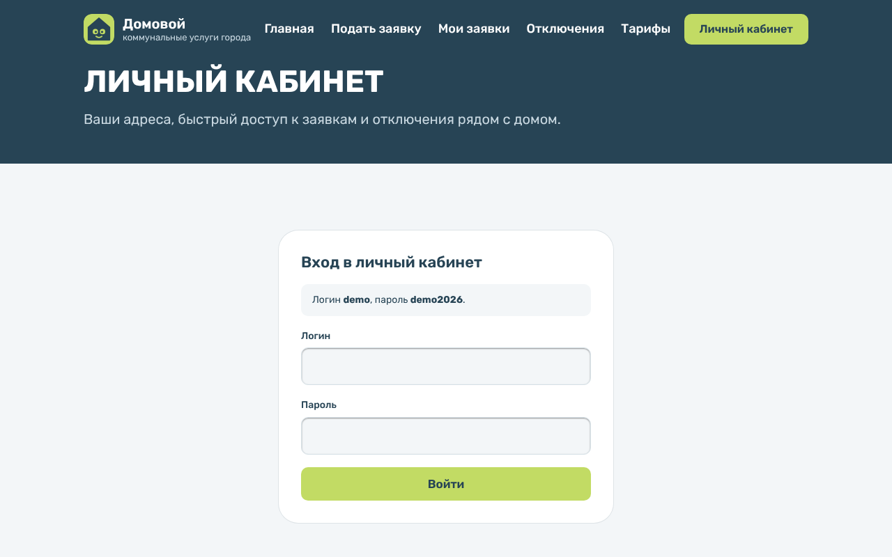
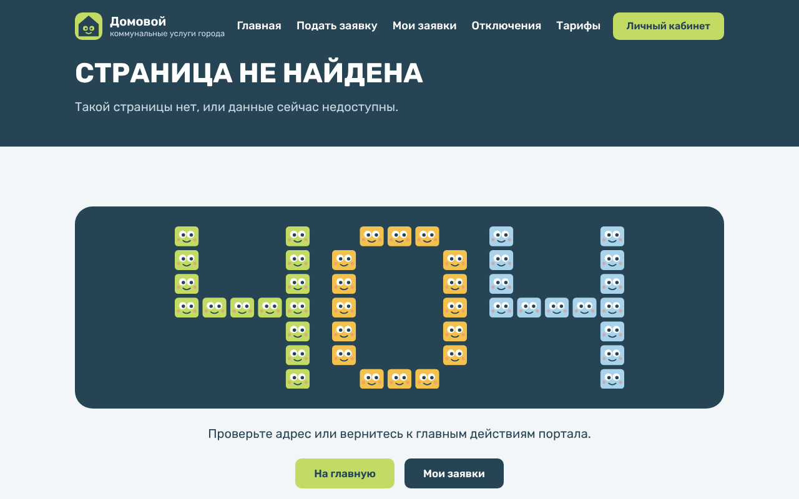
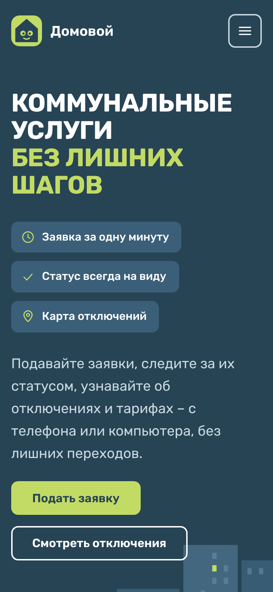
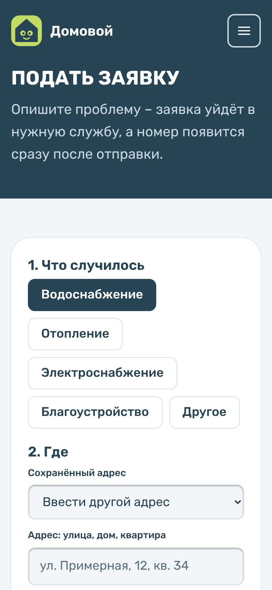
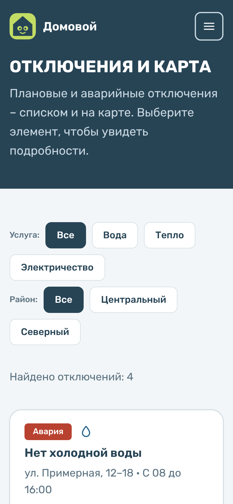

<div align="center">


# Домовой

**Городской портал коммунальных услуг**

Заявки, статусы обращений, отключения на карте, тарифы и личный кабинет – на одном сайте.

[](https://luchilica.github.io/domkom/)

[](https://github.com/luchilica/domkom/actions/workflows/pages.yml)
[](https://github.com/luchilica/domkom/actions/workflows/lint.yml)


</div>

## О проекте

Сайт помогает жителям города решать коммунальные вопросы без лишних шагов: подать заявку за минуту, видеть статус обращения, узнать об отключениях рядом с домом и найти нужный тариф или контакт организации.

- Адаптивная вёрстка от 360 px.
- Доступность по WCAG 2.2 AA: контраст, фокус с клавиатуры, подписи полей, `prefers-reduced-motion`.
- Данные хранятся в XML и читаются на странице без сервера.
- Карта отключений нарисована в SVG, шрифт Rubik размещён локально.

Курсовой проект (учебный) по предмету «Инструменты разработки веб-ресурсов», гр. ВР311. Данные на страницах вымышленные.

## Страницы

| Страница | Файл | Данные |
|---|---|---|
| Главная: быстрые действия, отключения, новости | [`index.html`](index.html) | `outages.xml`, `news.xml` |
| Подача заявки | [`request.html`](request.html) | `user.xml`, `requests.xml` |
| Статус заявок | [`requests.html`](requests.html) | `requests.xml` |
| Отключения и карта | [`outages.html`](outages.html) | `outages.xml` |
| Тарифы, справка и контакты | [`tariffs.html`](tariffs.html) | `tariffs.xml`, `contacts.xml` |
| Личный кабинет | [`cabinet.html`](cabinet.html) | `user.xml`, `requests.xml`, `outages.xml` |
| Страница ошибки и пустой результат | [`404.html`](404.html) | – |

## Галерея

<table>
  <tr>
    <td width="50%"><br><sub>Подача заявки</sub></td>
    <td width="50%"><br><sub>Статус заявок</sub></td>
  </tr>
  <tr>
    <td><br><sub>Отключения и карта</sub></td>
    <td><br><sub>Тарифы и контакты</sub></td>
  </tr>
  <tr>
    <td><br><sub>Личный кабинет</sub></td>
    <td><br><sub>Страница 404</sub></td>
  </tr>
</table>

### На телефоне

<table>
  <tr>
    <td align="center"></td>
    <td align="center"></td>
    <td align="center"></td>
  </tr>
</table>

## Запуск

```bash
npm install
npm run build      # SCSS → css/main.css (или npm run build:fallback без зависимостей)
npm start          # http://localhost:5173
```

Открывать нужно через веб-сервер: данные читаются из XML через `fetch`.
Вход в личный кабинет (имитация): логин `demo`, пароль `demo2026`.

## Структура

```text
.
├── index.html … 404.html   семь страниц сайта
├── scss/                   исходные стили (SCSS)
├── css/                    собранные стили
├── js/                     сценарии (DOM, формы, карта, окна)
├── data/                   XML: отключения, новости, заявки, тарифы, контакты, пользователь
├── assets/                 логотип, иконки, карта города, шрифт Rubik
├── docs/                   пояснительная записка и снимки для README
├── DESIGN.md               правила дизайна, токены, состояния, доступность
└── .github/workflows/      проверка кода и публикация на Pages
```

## Публикация и проверки

- **Pages.** Сайт публикуется автоматически при каждой отправке в `main` ([`pages.yml`](.github/workflows/pages.yml)). Включение: Settings → Pages → Source: GitHub Actions.
- **Lint.** Git Super Linter запускается при отправке и в запросах на слияние ([`lint.yml`](.github/workflows/lint.yml)).
- **Валидация.** Каждый `.html` проверяется в [W3C Markup Validation Service](https://validator.w3.org/).

## Документы

- [Пояснительная записка](docs/Пояснительная_записка.docx) с приложениями и листами графической части.
- [DESIGN.md](DESIGN.md) – палитра, типографика, компоненты.
- [Макеты в Figma](https://www.figma.com/design/uGvattni8130v6nWTfHDDg).

## Шрифт и фотографии

- Rubik размещён локально: `assets/fonts/Rubik-VF.woff` (лицензия SIL OFL).
- Фотографии на главной подключены с Unsplash (бесплатная лицензия). Для работы без интернета снимки можно скачать в `assets/img/` и заменить ссылки в `index.html`.

## Окна с глазами

На первом экране три окна на домах подмигивают по нажатию (мышь, касание, Enter или Space). Код: `js/app.js` (`initWindows`), стили: блок `.win` в `scss/main.scss`, разметка: `svg.hero__windows` в `index.html`.

<div align="center"><sub>Ботвич К. С., гр. ВР311 · 2027</sub></div>
