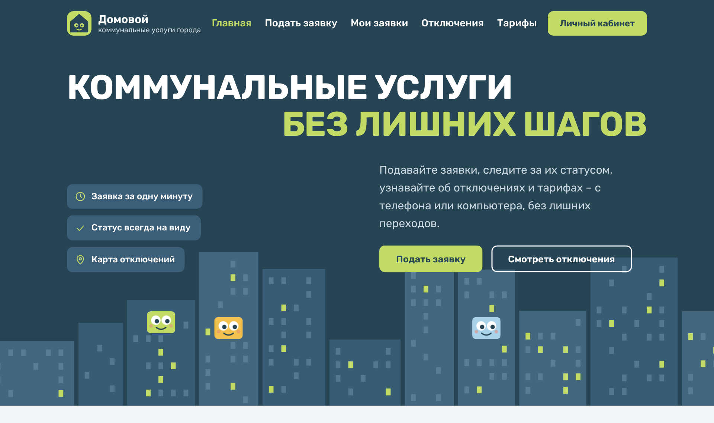

# Домовой – городской портал коммунальных услуг

**Сайт:** https://luchilica.github.io/domkom/

Подача заявок, статус обращений, отключения на карте, тарифы и контакты организаций, личный кабинет. Адаптивная вёрстка от 360 px, доступность по WCAG 2.2 AA.

Курсовой проект (учебный) по предмету «Инструменты разработки веб-ресурсов», гр. ВР311. Данные на страницах вымышленные.

Стек: HTML5, SCSS → CSS3, JavaScript (DOM), XML (папка `data/`), SVG (карта, иконки, логотип), Figma.

## Запуск

    npm install
    npm run build      # SCSS → css/main.css (или npm run build:fallback без зависимостей)
    npm start          # http://localhost:5173

Открывать нужно через веб-сервер: данные читаются из XML через `fetch`.
Вход в личный кабинет (имитация): логин `demo`, пароль `demo2026` (имитация, данные из `data/user.xml`).

## Страницы (ТЗ, раздел 1.2)

| Страница | Файл | Данные XML |
|---|---|---|
| Главная: быстрые действия, отключения, новости | `index.html` | `outages.xml`, `news.xml` |
| Подача заявки | `request.html` | `user.xml`, `requests.xml` |
| Статус заявок | `requests.html` | `requests.xml` |
| Отключения и карта (SVG) | `outages.html` | `outages.xml` |
| Тарифы и справка, контакты | `tariffs.html` | `tariffs.xml`, `contacts.xml` |
| Личный кабинет (имитация входа) | `cabinet.html` | `user.xml`, `requests.xml`, `outages.xml` |
| Вспомогательная: ошибка / нет данных | `404.html` | – |

## Публикация

Сайт публикуется на GitHub Pages автоматически при каждой отправке в ветку `main` (`.github/workflows/pages.yml`: сборка CSS, копирование файлов, развёртывание). Включение: Settings → Pages → Build and deployment → Source: GitHub Actions.

## Контроль качества

- Git Super Linter: `.github/workflows/lint.yml`.
- W3C Markup Validation Service: проверять каждый `.html` вручную на https://validator.w3.org/.
- Публикация: GitHub Pages (`.github/workflows/pages.yml`).

## Пояснительная записка

Текст записки с приложениями и листами графической части: [docs/Пояснительная_записка.docx](docs/Пояснительная_записка.docx).

## Дизайн

Правила дизайна, токены, состояния компонентов и критерии доступности: [DESIGN.md](DESIGN.md).

## Шрифт и фотографии

- Шрифт Rubik размещён локально: `assets/fonts/Rubik-VF.woff` (лицензия SIL OFL).
- Фотографии на главной подключены по ссылкам с Unsplash (бесплатная лицензия). Подписей с авторами на страницах нет. Для работы без интернета снимки можно скачать в `assets/img/` и заменить ссылки в `index.html`.

## Окна с глазами

На первом экране три окна на домах подмигивают по нажатию (мышь, касание, Enter/Space). Код: `js/app.js` (`initWindows`), стили: блок `.win` в `scss/main.scss`, разметка: `svg.hero__windows` в `index.html`.

## Макеты

Figma: https://www.figma.com/design/uGvattni8130v6nWTfHDDg
